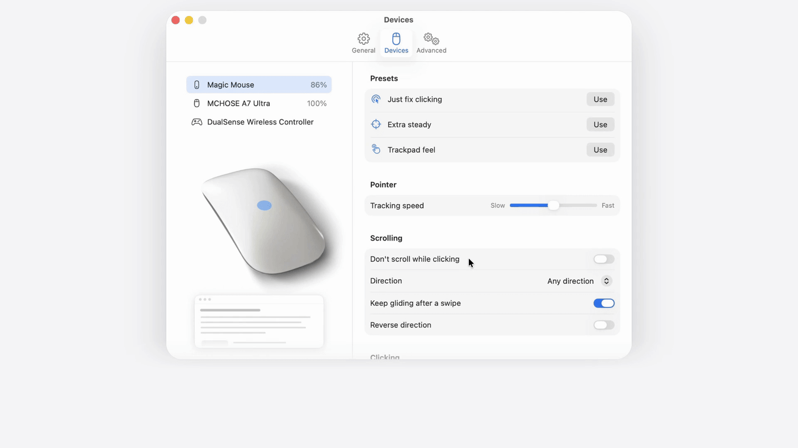
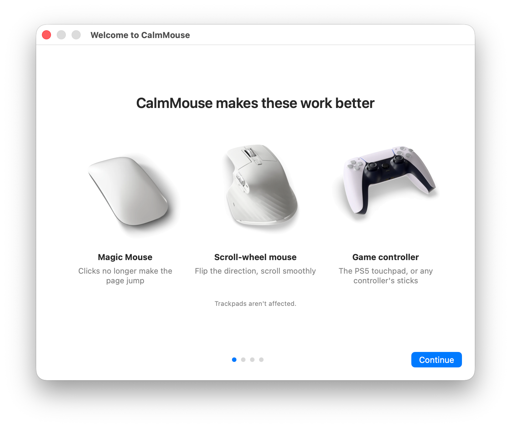

# HelloGitHub 自荐 issue（待批准，未提交）

提交到：https://github.com/521xueweihan/HelloGitHub/issues/new?template=submit-cn.yaml
表单：「提交项目」（submit-cn.yaml）。以下每一节对应表单的一个字段。

---

**Issue 标题**（表单会自动加前缀）

[开源推荐] CalmMouse：让妙控鼠标点击时不再顺带滚动页面（作者自荐）

**项目地址**

https://github.com/Malik1942/CalmMouse

**类别**

Swift

**项目标题**（≤ 50 字，现 26 字）

CalmMouse：让妙控鼠标点击时不再顺带滚动页面

**项目描述**（32–256 字，现 164 字）

妙控鼠标的整个上表面都是触控区，按下去时手指的轻微滑动会被当成滚动，于是页面在点击生效前先动了一下，点错按钮、拖错图层很常见。CalmMouse 是一个 macOS 菜单栏小工具，只在按键按下时拦住这点滚动，其它时候一切照常，触控板不受影响。新版也能让普通滚轮鼠标平滑滚动、单独设置方向，还能把 PS5 手柄的触控板当触控板用。

**亮点**

- 只解决一个具体的痛点：系统设置里没有这个开关；能处理它的 BetterTouchTool 是付费软件，Mac Mouse Fix 这类免费工具不支持妙控鼠标。
- 设置窗口里指向任意一项，左边渲染的鼠标就会演示这项设置的效果，不用读说明。
- 按 App 单独设置，比如在 Figma 里完全关掉妙控鼠标滚动，在浏览器里照常。
- 原生 Swift，用 CGEventTap 区分是哪个设备发出的滚动，手势状态机有单元测试，适合想了解 macOS 事件处理的人读源码。
- 免费、MIT 开源，已签名公证，简体中文、繁体中文、英文界面，支持 Homebrew 安装。

**示例代码**（可选，不填）

**截图或演示视频**

